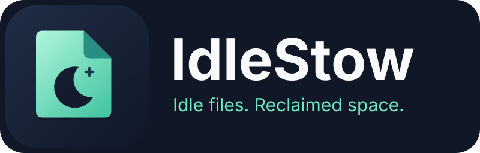

<p align="center">
  
</p>

<p align="center">
  <a href="LICENSE"></a>
  
  
  
</p>

# IdleStow

**Idle files. Reclaimed space.**

IdleStow is a free, open-source desktop application that finds files you are no longer using and
compresses them **losslessly and verifiably**, so you get disk space back without deleting anything.
It understands that one folder can contain both today's work and last year's notes: every file is judged
on its own evidence, and anything uncertain is left alone.

IdleStow is not a disk cleaner. It never deletes your files, it works only inside folders you
authorize, it runs fully offline, and every optimization can be undone.

> Status: **0.1.0, first release candidate.** Windows 10/11 on NTFS is the supported platform. Linux and
> macOS adapters exist but are **not verified** (see [compatibility](#supported-platforms)).

## Features

- **Persistent file index** of the folders you choose: metadata-only scanning, rename/move detection,
  filesystem watching with overflow-safe reconciliation, hundreds of thousands of files.
- **Evidence-based activity detection.** Modification, creation/copy, reliable last-access times (only
  where the volume really records them), files opened through IdleStow, and your own declarations.
  IdleStow's own reads are ignored, new files go through an observation period, and every
  classification comes with an explanation.
- **Mixed-activity folders handled per file.** Selecting a folder shows exactly which files will change
  and which stay untouched, and why.
- **Transparent NTFS compression** (Windows): the file keeps its path and opens normally. IdleStow
  verifies the compression state and the SHA-256 of the contents, and measures the real allocation
  before and after.
- **Archive compression** (ZIP, tar.zst) by a bundled Python worker, as either a compressed copy or a
  verified replacement. Replaced originals are retained for a period you choose before any space is
  reclaimed.
- **Three authorization modes.** *Manual*, *Ask before optimizing* (the default), and *Fully
  autonomous*, which is opt-in per folder, needs a confirmed policy, and uses reversible native
  compression only.
- **Recovery center**: decompress, restore in place or elsewhere (never overwriting), verify archive
  integrity, and recover automatically after crashes.
- **Honest storage accounting**: estimates are labelled as estimates, measured savings come from live
  data, and hard links are counted once.
- **Desktop app**: dashboard, explorer, recommendations, jobs, history (CSV/JSON export), settings,
  onboarding wizard, dark and light themes, system tray and an optional background mode.

## Screenshots

Screenshots are not committed yet. To capture your own from synthetic data:

```powershell
./scripts/generate-fixtures.ps1 -Out C:\IdleStowDemo -Preset mixed    # synthetic files only
./scripts/run.ps1                                                     # add C:\IdleStowDemo in onboarding
```

## Installation (Windows)

1. Download `IdleStow-0.1.0-windows-x64-portable.zip` from the GitHub releases page once a release is
   published, or build it yourself (see below).
2. Extract it anywhere and run `IdleStow\IdleStow.exe`. Java and Python are bundled, so nothing else
   needs to be installed.
3. Follow the onboarding wizard. Nothing is selected or modified until you choose folders and approve
   actions.

To uninstall, delete the `IdleStow` folder. Your files, archives and retained originals are never
removed by uninstalling. IdleStow's own data lives in `%LOCALAPPDATA%\IdleStow`, and you can remove it
too if you wish.

An MSI installer is built only when the [WiX Toolset](https://wixtoolset.org/) is installed on the build
machine. The current release is the portable package.

## Usage

1. **Add folders** (onboarding or *Settings → Monitoring*). IdleStow indexes them read-only.
2. Review the **Overview** and the **Explorer**. Every file shows its activity, its confidence, and the
   reason for both.
3. Open **Recommendations** and approve, reject, postpone, pin or exclude. Or select files or folders in
   the Explorer and choose *Optimize…* to see a full preview first.
4. Follow progress in **Jobs**. Results appear in **History** with measured savings.
5. Undo at any time from **Recovery**.

Command-line options: `--background` (start in the tray), `--read-only` (never modify files),
`--data-dir <dir>`, `--smoke-test`, `--self-test <empty dir>` (end-to-end test on synthetic files).

## How compression works

| Method | Space reclaimed | Accessibility | Undo |
|---|---|---|---|
| Transparent NTFS compression | Measured from real allocation (`GetCompressedFileSizeW`) | Unchanged: same path, opens normally | Decompress |
| Compressed copy (ZIP / tar.zst) | **None**. It uses extra space and is reported that way | Original untouched | Delete the copy |
| Archive replacement | Only after the retention period, once the archive is re-verified and the retained original removed | The file must be restored before other programs can open it | Restore (from the retained original or the archive) |

Files that are already compressed (JPEG, MP4, ZIP and so on) are detected by content sampling, not
just by extension. If compression would not save at least one cluster, IdleStow reverts it and records
"no benefit".

## Safety model

- Works only inside authorized folders. Revoking a folder takes effect at the next file, even mid-job.
- Mandatory protections that no policy can override: system folders, application data, executables,
  live databases, virtual disks, password vaults, development tooling folders, cloud-sync internals and
  cloud placeholders.
- Never follows links or junctions. Identity, size and modification time are re-checked immediately
  before every change, on the same OS handle that performs the NTFS operation.
- Every operation is journaled. After a crash, IdleStow completes it, rolls it back, or flags it for
  review. It never silently deletes anything.
- Approvals are tied to an exact plan, expire after 24 hours, and can be used once.
- Everything runs locally: no accounts, no telemetry, no network access and no AI service.

Details: [safety model](docs/architecture/safety-model.md) ·
[recovery state machine](docs/architecture/recovery-state-machine.md) ·
[threat model](docs/security/threat-model.md) · [recovery guide](docs/user-guide/recovery.md).

## Architecture

A modular Java monolith (`core`, `platform`, `app`) plus one persistent Python worker that talks to it
over a versioned JSON-lines protocol on stdio. See [docs/architecture/overview.md](docs/architecture/overview.md).

| Layer | Technology |
|---|---|
| UI | JavaFX 21 |
| Core | Java 21, SQLite (sqlite-jdbc, WAL), Jackson, SLF4J/Logback |
| Windows integration | JNA: `DeviceIoControl` (`FSCTL_GET/SET_COMPRESSION`), `GetCompressedFileSizeW`, `GetFileInformationByHandle`, `GetVolumeInformationW` |
| Worker | Python 3.12: `zipfile`, `tarfile`, `hashlib`, `zlib`, optional `zstandard` |
| Build | Maven Wrapper, jpackage/jlink, pytest, Ruff, GitHub Actions |

## Supported platforms

| Feature | Windows 11 / NTFS | Windows 10 | Linux | macOS |
|---|---|---|---|---|
| Indexing, activity analysis, recommendations | Supported and tested | Implemented, not verified | Implemented, not verified | Implemented, not verified |
| Transparent native compression | Supported and tested (NTFS, ≤ 4 KiB clusters) | Implemented, not verified | Unsupported (Btrfs: planned) | Unsupported (planned) |
| Archive copy/replace + restore | Supported and tested | Implemented, not verified | Implemented, not verified | Implemented, not verified |
| Desktop UI, tray | Supported and tested | Implemented, not verified | Implemented, not verified | Implemented, not verified |
| Packaged application | Portable image, tested | Not verified | Planned | Planned |

## Building from source

Requirements: JDK 21+, Python 3.12+, Git. Maven is provided by the wrapper.

```powershell
./scripts/setup-dev.ps1          # Python dev tools in python/.venv
./scripts/build.ps1              # ./mvnw package
./scripts/run.ps1                # run with a throw-away data directory (target/dev-data)
./scripts/package-windows.ps1    # dist/windows/IdleStow + portable zip (downloads a pinned Temurin JDK and CPython, verified by SHA-256)
```

## Testing

```powershell
./scripts/test.ps1               # Ruff + pytest + ./mvnw verify (unit, integration, native NTFS, GUI smoke)
```

All tests use synthetic files in temporary directories. Native NTFS tests (`@Tag("native")`) run only on
Windows. Benchmarks are opt-in:

```powershell
./mvnw -pl platform test -Dtest=IndexingBenchmark -Dsurefire.excludedGroups= -Dbench.sizes=1000,10000,100000
cd python; python -m idlestow.benchmarking --size-mib 64
```

The latest real results are in [docs/development/TEST_RESULTS.md](docs/development/TEST_RESULTS.md).

## Contributing

Contributions are welcome. Please read [CONTRIBUTING.md](CONTRIBUTING.md), the
[code of conduct](CODE_OF_CONDUCT.md) and the [security policy](SECURITY.md).

## License

Copyright 2026 Mansoor Alakoozai. [Apache License 2.0](LICENSE). Third-party components are listed in
[THIRD-PARTY-NOTICES.md](THIRD-PARTY-NOTICES.md). Privacy: [PRIVACY.md](PRIVACY.md) (IdleStow collects nothing; everything stays on your computer).
