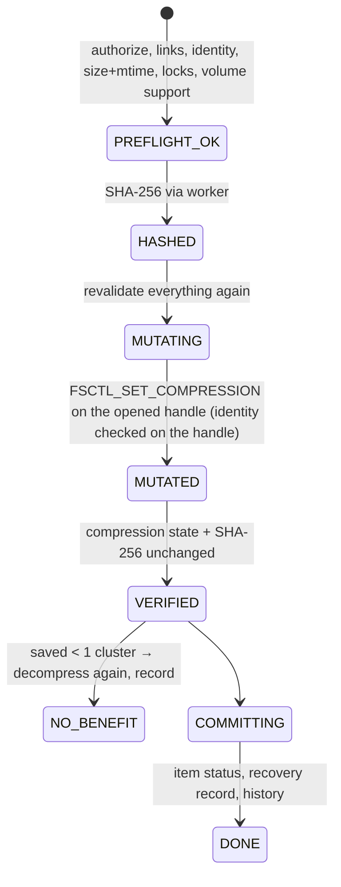

# Operation state machine and crash recovery

Filesystem changes and SQLite transactions cannot commit atomically together, so every file
operation is an explicit, journaled state machine (`core/jobs/OperationExecutor.java`). Each step is
written to `operation_journal` (durable, `synchronous=FULL`) **before** the corresponding filesystem
change. On startup `CrashRecovery` inspects every operation that did not reach a terminal state and
decides, from the journal **and the actual files on disk**, whether to complete it, roll it back, or
flag it for review. Nothing is deleted during recovery unless the journal proves IdleStow created it
and the original is intact.

Terminal operation states: `DONE`, `FAILED`, `ROLLED_BACK`, `CANCELLED`, `NO_BENEFIT`, `REVIEW`.

## Native (transparent) compression

| Interrupted after | Recovery action |
|---|---|
| before `MUTATING` | rolled back (nothing changed) |
| `MUTATING`/`MUTATED`/`VERIFIED`/`COMMITTING` | inspect file: not compressed → rolled back; compressed **and** SHA-256 equals journaled hash → completed; otherwise → REVIEW, item flagged *Recovery required* |

## Archive replacement (and archive copy)

```mermaid
stateDiagram-v2
    [*] --> PREFLIGHT_OK: + hard links = 1, no ADS, not system/encrypted/sparse/cloud, same volume as root, free space
    PREFLIGHT_OK --> HASHED
    HASHED --> ARCHIVE_TMP_CREATING: worker streams source → .name.idlestow-tmp-XXXX.zip (exclusive create, fsync)
    ARCHIVE_TMP_CREATING --> ARCHIVE_VERIFIED: full decompression, SHA-256 == source hash, member allow-list
    ARCHIVE_VERIFIED --> MANIFEST_WRITTEN: JSON manifest in data dir (+ retention dir)
    MANIFEST_WRITTEN --> ARCHIVE_PLACED: revalidate source; atomic rename tmp → name.idlestow.zip (no replace)
    ARCHIVE_PLACED --> COMMITTING: (copy mode)
    ARCHIVE_PLACED --> ORIGINAL_RETAINED: (replace mode) atomic move original → .idlestow/retained/<uuid>/
    ORIGINAL_RETAINED --> COMMITTING
    COMMITTING --> DONE
```

| Interrupted after | Recovery action |
|---|---|
| before `ARCHIVE_PLACED` | original untouched → delete only IdleStow's own temp file → rolled back |
| `ARCHIVE_PLACED` (original still in place) | archive verified → recorded as a compressed copy (both copies exist); unverifiable → REVIEW |
| `ORIGINAL_RETAINED` | archive verified and retained original present → completed; else REVIEW (retained original is never deleted) |

The original is **never deleted** by an optimization. It is moved into the retention store and only
removed by an explicit *Reclaim space* (purge) operation, which first fully re-verifies the archive.
Until then, no space is reported as reclaimed.

## Restore

`PREFLIGHT_OK` → (`RETAINED_MOVING` if a verified retained original exists | `RESTORE_TMP_CREATING`:
worker extracts to an exclusive temp file with a size cap and hash check) → `RESTORED_PLACED`
(atomic rename, never replacing an existing file) → `VERIFIED` (SHA-256 of the restored file) →
archive / retention removed → `DONE`.

| Interrupted after | Recovery action |
|---|---|
| before placement | temp file removed, rolled back; archive and record unchanged |
| `RESTORED_PLACED` or later | restored file verified → record set to REVIEW and the archive is **kept** for the user to remove |

## Tests

`core/src/test/java/.../jobs/CrashRecoveryTest.java` injects a simulated crash (an uncaught `Error`)
at every step above (`NATIVE_BEFORE_MUTATION`, `NATIVE_AFTER_MUTATION`, `NATIVE_BEFORE_COMMIT`,
`ARCHIVE_BEFORE_TMP`, `ARCHIVE_AFTER_TMP`, `ARCHIVE_AFTER_VERIFY`, `ARCHIVE_AFTER_PLACE`,
`ARCHIVE_AFTER_RETAIN`, `RESTORE_BEFORE_EXTRACT`, `RESTORE_BEFORE_MOVE`, `RESTORE_AFTER_PLACE`,
`PURGE_BEFORE_DELETE`), restarts the engine on the same data directory and asserts that a verified
copy of the data still exists and the operation ended completed, rolled back, or flagged.
